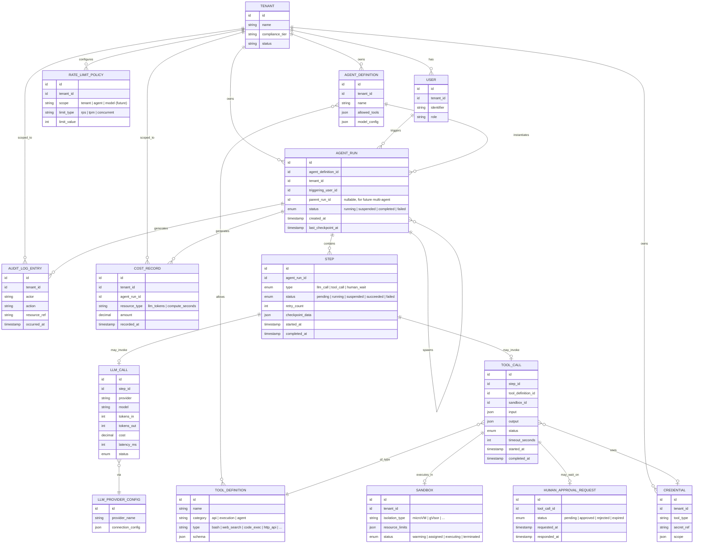

See also: [problem-statement.md](problem-statement.md) — the verbatim source
spec. This document tracks it; where they diverge, this document is wrong.

# Agent Orchestration Framework — Requirements (Working Draft)

Status: living document, captured incrementally during requirements brainstorm.
Legend: `[DECIDED]` locked in from discussion, `[OPEN]` still to resolve, `[FUTURE]` explicitly deferred but must not be architecturally foreclosed.

## 1. Context

Enterprise agent orchestration framework. Agents are given access to tools (bash,
web-search, code execution, ...) and run on behalf of external SaaS tenants.
Core pillars: sandboxing, scale, failure handling, rate limiting, tenant isolation.

## 2. Functional Requirements

| ID | Requirement | Status |
|----|-------------|--------|
| FR1 | Agents are defined with a configurable set of tools they may call (bash, web-search, code execution, extensible to more). | DECIDED |
| FR2 | Each tool call executes inside an isolated sandbox, provisioned per call. | DECIDED |
| FR3 | Tenants bring their own credentials/API keys for tools; these are stored per-tenant and never cross tenant boundaries. | DECIDED |
| FR4 | Tool calls vary from seconds (web-search, small bash/code) to hours (heavy code execution) to days (human-in-the-loop reply). The framework must support all three as first-class, not just the short case. | DECIDED |
| FR5 | An agent run must be resumable from its last checkpoint after a pod/process failure, without re-running completed steps. | DECIDED |
| FR6 | Rate limits are enforced per tenant (first increment). Design must not preclude adding per-agent and per-model limits later. | DECIDED (per-tenant), OPEN (per-agent/per-model — defer, don't foreclose) |
| FR7 | LLM access goes through a provider-agnostic interface. Single provider (Anthropic) wired up now; multi-provider must be addable without reworking the core. | DECIDED |
| FR8 | A waiting agent (e.g. mid human-in-the-loop, or queued) must consume ~0 compute — no process/pod held open per waiting agent. | DECIDED |
| FR9 | Runaway tool executions are hard-killed at a wall-clock limit, independent of agent/LLM logic. | DECIDED |
| FR10 | Full observability: tracing across agent run → step → tool call → sandbox, plus per-tenant/per-run cost monitoring (LLM token spend, compute spend). | DECIDED |
| FR11 | Audit trail of agent/tool actions for compliance purposes, at command-level granularity for execution-tool calls — must be able to answer "show every command agent X ran on a given day." Creates a tension with FR12 when a secret is embedded inside a command string itself (e.g. a `--token=...` flag) rather than passed as a separate credential — that case needs in-command redaction, not just avoiding a separate credential field. | DECIDED (exists), OPEN (retention/compliance regime, in-command redaction mechanism) |
| FR12 | No sensitive data (tenant credentials, secrets, raw PII) is ever logged or persisted outside the dedicated secret store — audit/observability data is redacted by construction. | DECIDED |
| FR13 | Tool credentials never enter the LLM's context: the model sees only a tool name + parameters and decides to call it on that basis; the actual credential value is injected at the execution layer (sandbox or API-call proxy), after the model's decision, never before or visible to it. | DECIDED |
| FR14 | Every tool call is attributable to the agent, the tenant, *and* the triggering human user (not just the tenant) — requires a `USER` concept in the data model, not just `TENANT`. | DECIDED |
| FR15 | Tool calls split into three categories with different handling: **API tools** (HTTP calls to internal/third-party services using tenant credentials), **execution tools** (arbitrary Python/Node/Bash and CLIs like pandoc/gh/jq/curl/git), and **agent tools** (an agent-to-agent call, carrying its own identity/tenant/audit trail, through the exact same gateway — no side channel around authorization). Only execution tools necessarily require a full sandbox; API and agent tools may be served by lighter-weight paths (a credential-injecting proxy, or the gateway creating a child `AGENT_RUN`, respectively). See [assumptions.md](assumptions.md). | DECIDED |

## 3. Non-Functional Requirements

| ID | Requirement | Status |
|----|-------------|--------|
| NFR1 | Throughput: **~10k tool calls/*minute*** (~167/sec) at peak, confirmed as the actual target (not a stricter self-imposed bar) — corrected from an earlier draft that assumed 600x this. Architecture must scale ~10x further (~100k/min, ~1,670/sec) without a redesign — treat as a future scaling exercise, not a day-1 build target. At this scale, none of the engine/language leans made so far are under real throughput pressure. | DECIDED |
| NFR2 | Concurrency: ~1000 concurrent agents (spec says "100s distinct agents concurrently," with ~1000 used as the working number). Given FR8, "active" is dominated by suspended/durable state, not live processes — real pressure is on scheduler/queue throughput, not on holding live workers. | DECIDED |
| NFR3 | Tenant isolation is adversarial-grade: tenant-supplied prompts/code are assumed hostile. Sandbox boundary must hold against a malicious tenant, not just accidental misbehavior. | DECIDED |
| NFR4 | Security: encryption at rest and in transit for all tenant data and credentials; per-tenant secret isolation; least-privilege access to sandboxes and tool credentials. | DECIDED |
| NFR5 | Durability: no silent loss of agent progress on pod/node death (ties to FR5). | DECIDED |
| NFR6 | Extensibility: tools and LLM providers are pluggable via stable interfaces, not hardcoded integrations. | DECIDED |
| NFR7 | Portability: primary deployment is cloud-native K8s (new cluster, no existing one to integrate with); on-prem/hybrid is a follow-up — avoid gratuitous cloud-proprietary lock-in where it's cheap to do so, but don't over-engineer for on-prem now. | DECIDED |
| NFR8 | Cost efficiency: idle sandboxes and suspended agents must not accrue compute cost. | DECIDED |
| NFR9 | Compliance target (SOC2 / HIPAA / FedRAMP / none specified). | OPEN |
| NFR10 | Multi-region / data residency requirements. | OPEN |
| NFR11 | Availability target (SLA, e.g. 99.9%) and per-tenant SLA tiering. | OPEN |
| NFR12 | Architecture-significant decisions (e.g. durable execution engine choice) must be backed by an explicit cost + data-scale calculation (infra cost, storage growth under projected throughput/retention, throughput headroom) before being finalized. | DECIDED |
| NFR13 | Kubernetes-native by default: scheduling, isolation, scaling, and failure handling should use Kubernetes primitives. Any choice that isn't a native K8s primitive (e.g. a workflow engine, a sandbox runtime) must carry an explicit justification in its own topic document, not just an implicit assumption. | DECIDED |

## 4. Entity-Relationship Diagram (conceptual)

See also: [durable-execution-engine.md](durable-execution-engine.md) for the
evaluation behind how `AGENT_RUN`/`STEP` are executed and checkpointed.

Conceptual data model — not a physical schema yet. Captures the entities implied
by the requirements above: tenant-owned agent definitions, durable agent runs
made of steps, steps that invoke LLM calls or tool calls, tool calls that execute
in sandboxes and may block on human approval, plus the cross-cutting concerns
(credentials, rate limits, cost, audit).

Notes on the ERD:
- `CREDENTIAL.secret_ref` is a pointer into a dedicated secret store (e.g. Vault/KMS), never the secret value itself — the ERD intentionally has no column that holds raw secret material, per FR12/NFR4.
- `STEP.checkpoint_data` is what makes FR5/FR8 possible: a suspended step is just a row, not a process. `AGENT_RUN` + `STEP` together are effectively an event-sourced log, not a snapshot — likely append-only in the real schema.
- `HUMAN_APPROVAL_REQUEST` is modeled as a first-class entity (not just a tool call with a long timeout) because its failure/expiry semantics differ from a hung tool call (FR4).
- `TOOL_DEFINITION.category` (`api` vs. `execution`) determines the execution path: an `execution`-category `TOOL_CALL` runs in a `SANDBOX`; an `api`-category one plausibly doesn't need a full sandbox at all and can be served by a lighter-weight credential-injecting proxy — the `SANDBOX` relationship on `TOOL_CALL` is optional (`o|`) for exactly this reason (FR15). Either way, the credential is injected at that execution layer, never passed into the LLM's context (FR13).
- `AGENT_RUN.triggering_user_id` (and the `USER` entity generally) exists so every tool call is attributable to agent, tenant, *and* triggering human — not just tenant (FR14). `AUDIT_LOG_ENTRY` resolves the triggering user by joining through `AGENT_RUN`, rather than duplicating `user_id` on every entry.
- Command-level audit logging (FR11) and "never log sensitive data" (FR12) are in tension whenever a secret is embedded inside a command string itself (e.g. a CLI flag like `--token=...`), not just when it's a separate credential field — the audit pipeline needs in-command secret redaction, not just avoidance of a credential column. Mechanism not yet decided.
- `AGENT_RUN.parent_run_id` (self-referencing, nullable) exists for future multi-agent support (a parent run spawning/coordinating child runs) — see [agent-model.md](agent-model.md) and [assumptions.md](assumptions.md). The POC never populates it; its presence now avoids a schema migration later. An agent-to-agent call is modeled as a `TOOL_CALL` with `TOOL_DEFINITION.category = "agent"`, not a bespoke `STEP` type — the gateway sets the child's `parent_run_id` when it creates the child run, and the call goes through the same authorization/credential/audit/rate-limit path as any other tool call.

See also: [poc-vs-production.md](poc-vs-production.md) — tracks every
deliberate POC-phase shortcut against a locked requirement, with a priority
for closing it before production. See also:
[major_calls.md](major_calls.md) — the register of big, hard-to-reverse
architectural decisions, for fast skimming.

## 5. Open Items (for next rounds)

- NFR9: Compliance target (SOC2 / HIPAA / FedRAMP / none)
- NFR10: Multi-region / data residency
- NFR11: Availability SLA and per-tenant tiering
- Durable-execution engine choice: see [durable-execution-engine.md](durable-execution-engine.md) — leaning Temporal (self-hosted) or custom-build, pending cost + data-scale calculation (NFR12)
- Credential storage mechanism (Vault, cloud KMS + envelope encryption, etc.)
- Sandbox design (tech choice, warm pools, resource limits, egress control): see [sandbox-design.md](sandbox-design.md)
- Durability & resilience (surviving pod restart/deployment/node drain mid-task): see [durability-and-resilience.md](durability-and-resilience.md)
- Observability & cost monitoring (live agent status, tracing, per-tenant cost): see [observability-and-cost-monitoring.md](observability-and-cost-monitoring.md)
- Implementation language & framework (Go vs. Python vs. polyglot): see [language-and-framework-choice.md](language-and-framework-choice.md)
- What is an agent — single tool-loop vs. graph-reasoning vs. multi-agent team, and whether an open-source framework's engine composes with Temporal: see [agent-model.md](agent-model.md) (foundational — may revise the ERD and the language choice above)
- State store (the actual DB behind the ERD's entities — Postgres vs. CockroachDB vs. other, and how it relates to whatever the durable-execution engine needs): see [state-store.md](state-store.md) — a "must state" item per the spec
- How agents are defined and versioned (ties directly to the workflow-versioning concern already flagged in durable-execution-engine.md and durability-and-resilience.md): see [agent-definition-and-versioning.md](agent-definition-and-versioning.md) — a "must state" item per the spec
- Trust-level-dependent sandbox isolation (spec: agents have varying "trust levels") — added as a question in [sandbox-design.md](sandbox-design.md)
