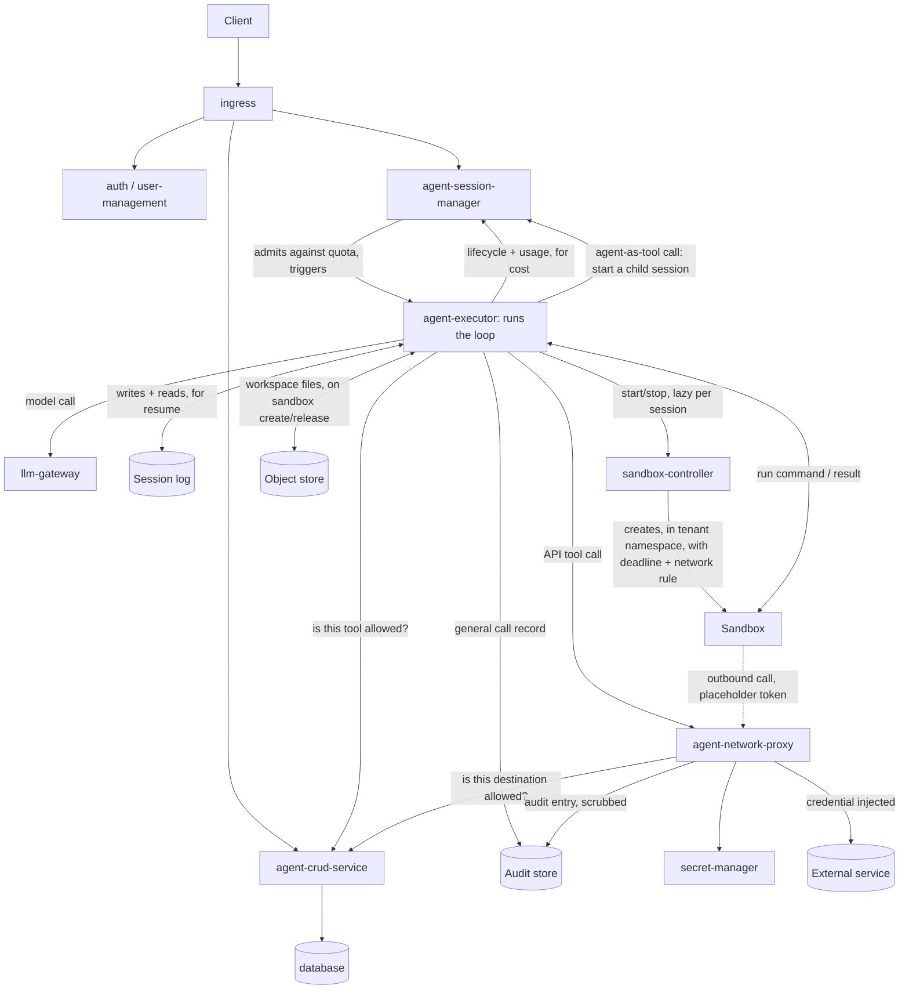
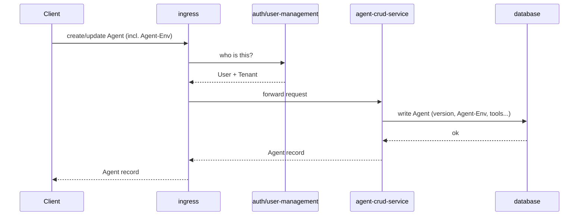
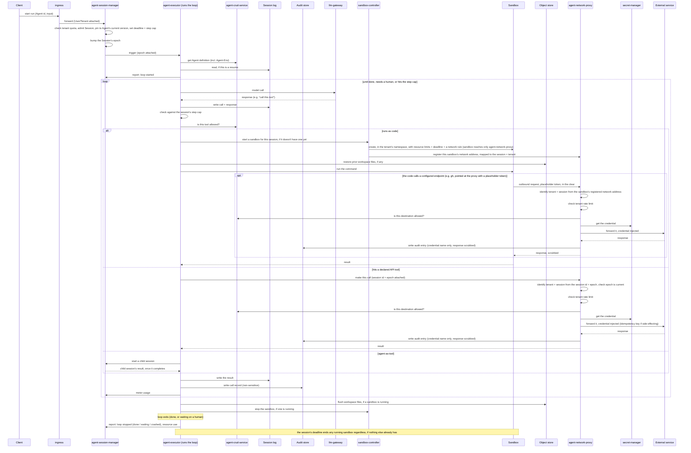
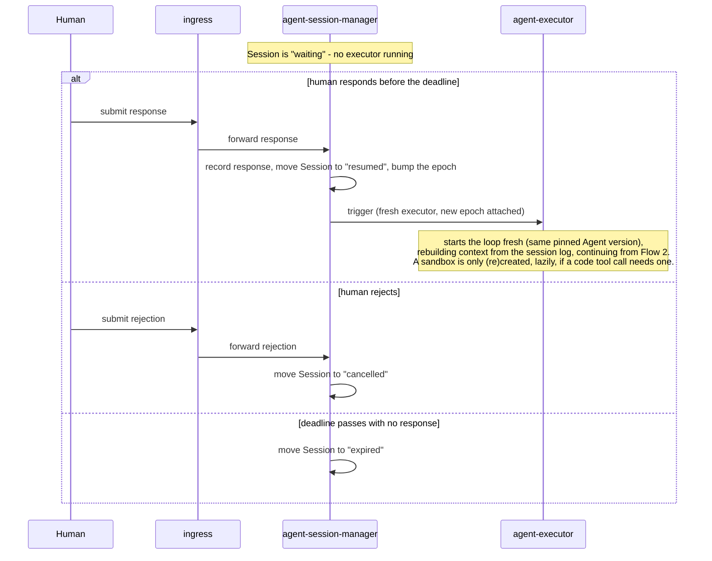

# High-Level Service Architecture

## The entities

- **Agent** — a definition: version, LLM model, system instructions, a set of files, the list of tools it's allowed to use, and its Agent-Env config (see below).
- **Agent Session** — one run, pinned to the Agent version it started with for its whole lifetime, even if the Agent is edited while it's running. Holds its state (created → admitted → waiting → resumed → cancelled/expired/done), a deadline, a step cap, an epoch (bumped each time agent-session-manager triggers a fresh executor for it, so a stale one can't still take effect), and its usage/cost totals — reported by agent-executor, which sees the whole run end to end. Two other records live outside it: the session log (agent-executor's own working record of the loop — what it reads back to resume) and the audit store (the compliance record of every call, written partly by agent-executor and partly by agent-network-proxy). Workspace files produced during the run live in an object store. Session-manager itself holds none of this — just status, deadline, and the totals.
- **Secrets** — a tenant's credentials. Referenced by name wherever they're used or logged; the actual value is never written down outside secret-manager.
- **Agent-Env** — the environment a run executes in: what it can reach on the network, its resource limits, its isolation level. Not its own service or its own call — it's just a field on Agent, served by agent-crud-service in the same lookup as the rest of the Agent definition.
- **User** — belongs to a Tenant. Just enough to know who triggered a given Session.

## The services

- **ingress** — the one entry point every client request comes through. Checks who's calling (via auth/user-management) and routes the request on: agent management → agent-crud-service, runs → agent-session-manager.
- **auth / user-management** — verifies the caller and resolves their User/Tenant.
- **agent-crud-service** — create/update/version Agents (including their Agent-Env config and the grants that say what they're allowed to call), backed by its own database. Both agent-executor (is this tool allowed?) and agent-network-proxy (is this destination allowed?) read grants from here — neither holds its own copy of policy.
- **secret-manager** — store and hand out Secrets. The only caller is agent-network-proxy; nothing else ever reaches it.
- **agent-session-manager** — owns the lifecycle of a Session, and only that — status, deadline, and usage/cost totals. It never holds the call-by-call record; that's the session log and the audit store's job, not its. On a start request, it checks the tenant's admission quota, pins the Session to the Agent's current version, sets its deadline and a step cap (a hard ceiling on how many tool calls this one session can make, regardless of type — the backstop against a runaway loop), and triggers an agent-executor. It's the front door for the client — start a run, submit a human response or rejection, cancel, check status — and it's lightweight and long-lived, since a session can sit waiting for days. A waiting session that passes its deadline with no response is expired; an explicit reject ends it. Today this is built as a state table plus a reconciler that watches for a session whose desired state doesn't match reality (nothing's progressed, nothing's reported back) and retriggers an executor — it doesn't need to know *why* there's a mismatch, crashed sandbox and crashed executor look the same to it. Each trigger bumps the Session's **epoch**, a number agent-executor carries on every call it or its sandbox makes — this is the fencing that stops a zombie executor the reconciler gave up on too early from still taking effect once a fresh one has taken over the same session. A durable-execution engine (e.g. Temporal) is the upgrade once timers, retries, or approval semantics outgrow what a table + reconciler can carry.
- **agent-executor** — owns and runs the session's reasoning loop (decide, call the model, pick a tool) as our own stateless platform code, not inside a sandbox. It calls llm-gateway directly for model calls, and checks a tool call against the Agent's grants and the session's step cap itself (a policy lookup against agent-crud-service, no secret involved) — the step cap is what catches a runaway loop regardless of whether it's calling code or an API, since every tool call passes through this one check. It writes its own working record of the loop to the session log (and reads it back to resume) and writes the non-sensitive half of the audit trail. It holds no cluster/infra permissions and never touches a secret: for a code/CLI tool it asks sandbox-controller to create a sandbox, then talks straight to it (sending the command, reading the result); for an API tool, or anything the running code calls out to, it's agent-network-proxy that actually makes the call — agent-executor just asks for it and gets a result back. For an agent-as-tool call it skips both and asks agent-session-manager directly to start a child session. It sends a heartbeat to agent-session-manager so "is this loop still alive" doesn't depend on a full status report. Because the loop is stateless and rebuilds its context from the session log, a crash of the loop or a lost sandbox is a retry, not a lost run.
- **sandbox-controller** — the one piece with cluster/infra permissions, and the only thing it does: create a sandbox in a tenant's namespace — with its resource limits, the session's deadline as its hard kill, and a network rule that lets only agent-executor reach it and lets it reach only agent-network-proxy — and stop one when agent-executor says to. It registers the new sandbox's network address with agent-network-proxy, mapped to that session and tenant, so the proxy can identify a call that comes straight from the sandbox. It never runs code itself and never sees a secret. Keeping this the *only* cluster-permissioned piece means the one component that could pivot across tenant infrastructure if compromised has almost nothing else to do, and nothing worth taking.
- **agent-network-proxy** — the only thing a sandbox can ever reach, and the only component that ever touches a real credential value; nothing else does, including agent-executor. It identifies the caller two ways: a call from agent-executor carries the session id and its current epoch explicitly (checked against agent-session-manager's state — a stale epoch, from an executor the reconciler already gave up on, is rejected); a call straight from a sandbox is identified by its network address, which sandbox-controller registered at creation. Nothing is ever taken from what the request itself merely claims.
  - **A tool whose endpoint can be reconfigured** — a declared API tool, an MCP server, or a CLI like `gh`, *if* it accepts a custom host — gets pointed at the proxy's own address at sandbox start, with a placeholder token. It sends its request to the proxy directly, in the clear, over the internal network; no certificate trickery needed, since the sandbox never opens a connection meant for the real destination in the first place. (Whether `gh` specifically accepts this isn't confirmed yet.)
  - **A tool with a hardcoded endpoint**, that can't be redirected by configuration, needs the other mechanism: sandbox-controller installs a CA certificate the proxy controls into the sandbox's trust store, and routes the sandbox's HTTPS traffic to the proxy transparently. The proxy terminates the connection with a certificate it signs on the fly for whatever host the tool thinks it's calling, swaps the placeholder token for the real credential in whatever field the tool put it, and opens its *own* fresh HTTPS connection to the real destination. This fails closed — not insecurely open — for any tool that pins a certificate or authenticates with its own client certificate (mTLS); reading that traffic would mean breaking the trust it's built on, so it simply doesn't get a credential either way.
  - Either way, the proxy checks the destination against the session's grants and the tenant's rate limit, fetches the credential from secret-manager, forwards the request (an idempotency key attached if side-effecting), scrubs the response, and writes the audit entry — logging the credential's *name*, never its value.
  - Traffic neither mechanism covers still only reaches the proxy, since that's the sandbox's one allowed destination — but now the proxy is just relaying bytes it was never meant to open, so it can allow or deny by the destination it can see and nothing more. The call reaches the real destination with no credential and usually fails — by design, not a gap to close.
  - It's stateless and horizontally scaled — at the brief's stated peak (~170 calls/sec) that's the only way a single enforcement point like this holds up; any central chokepoint carries this same cost. Either mechanism could in principle cover gRPC too, but that relay isn't built; raw TCP has no generic credential slot regardless of how it's addressed. See **PROXY-1** in [poc-vs-production.md](poc-vs-production.md), and [how-does-network-calls-work.md](how-does-network-calls-work.md) for both mechanisms worked through in full, including the one-line tradeoff between them.
- **llm-gateway** — every model call goes through here, called directly by agent-executor. Rate limits and cost tracking live here.
- **object store** — holds workspace files produced during a run. Restored into a fresh sandbox on start, flushed back out on stop/exit — not part of the Session record itself.
- **session log** — agent-executor's own append-only record of the loop: every model response, every tool call and result, in the order they happened. This is what a resumed or restarted loop reads back to pick up where it left off — written and read only by agent-executor.
- **audit store** — a separate, append-only compliance record, not the same thing as the session log above. Holds the actual call-by-call trail — every model call, every tool call, who/what triggered it, credential names only — written partly by agent-executor (the non-sensitive "a call happened" record) and partly by agent-network-proxy (anything that touched a credential, scrubbed). This is the real answer to "show every command agent X ran," kept apart from session-manager's status/usage data and from the session log so each can scale, retain, and be secured differently.
- **trace store** — every component emits its traces/logs/metrics here, tagged with tenant, agent, session, and triggering user. The session id is the trace id and the step number is the span, so "what happened in this run" is one trace lookup, not a cross-service hunt.
- **rollup job** — sums the usage records each component already reports (tokens/model cost from llm-gateway, sandbox time from sandbox-controller, outside call counts from agent-network-proxy) per tenant, agent, and day, and raises an alert — telling agent-session-manager to refuse new runs at admission — if a tenant crosses its budget threshold.

## Hard problem: the agent must never get a token or secret

Most of the privilege-splitting in this design exists to hold this one
line. Current best-shot mechanism: a network rule lets a sandbox reach
only agent-network-proxy, the one component that ever touches a real
credential value. A sandbox only ever holds a placeholder token; the swap
happens at the proxy — either because the tool was pointed at the proxy
directly, or, for a tool with a hardcoded endpoint, because the proxy
intercepts and decrypts the traffic itself using a certificate it
controls. Called out here
explicitly because it's genuinely hard, not because it's settled: worth a
hard look during review for whether this split is earning its complexity,
or whether there's a simpler way to get the same guarantee.

## Where the agent loop runs: decision and tradeoffs

Two ways to run the reasoning loop were considered:

- **Option A — the platform runs the loop (chosen).** The loop is our own trusted code, hosted by agent-executor itself, not a sandbox. It calls llm-gateway directly for every model call. A sandbox is created lazily — only on a session's first tool call that actually needs to run code — kept around just for that session (so workspace files survive across calls), and released once idle.
- **Option B — the sandbox runs the loop (the earlier design, not chosen).** The loop itself ran inside a sandbox started for the whole session, talking out to a mediating gateway over a session token minted just for it.

Why A:
- **The grant check becomes a real control, not just audit.** Code only runs because the trusted loop asked the sandbox to run it — there's no agent-controlled shell to bypass that with. In B the loop and the shell shared a process, so the check was advisory at best; that gap goes away.
- **Lower idle cost.** A session that only calls models and APIs never pays for a sandbox at all. One that needs code gets it lazily, not for the whole session.
- **Simpler resume.** The loop is stateless and rebuilds its context from the session log; a lost sandbox is a tool-call error to retry, not lost run state.
- **Fewer security parts.** No session token to mint, no sandbox able to claim an identity it doesn't have — agent-network-proxy identifies a sandbox by its registered network address and an executor by its session id and epoch, never by anything a request claims. A sandbox can reach exactly one thing — agent-network-proxy — and only ever holds a placeholder token; the real credential is swapped in at the proxy, either directly or via a certificate it controls, so neither the sandbox nor the trusted loop ever sees it. It also let cluster/infra permissions shrink to their own narrow piece (sandbox-controller), since agent-executor no longer needs them for anything but asking that piece to create or stop a sandbox.
- **Smaller escape blast radius.** An escaped sandbox exposes one code call, not the whole run.
- **Smaller design overall.** Fewer moving parts to build.

The cost: the loop now runs as shared, multi-tenant platform code, so a bug in it can cross tenants — before, each tenant's bug was contained to its own sandbox. It still can't leak a secret (agent-network-proxy owns those, never the loop), but it's a real regression for anything else a loop bug could do. Mitigate with per-tenant worker pools or namespaces for loop workers; not yet decided which, and not yet built — tracked as **LOOP-1** in [poc-vs-production.md](poc-vs-production.md).

**Upgrade path, if a tenant ever needs to bring their own loop code** (e.g. a LangGraph graph instead of ours): that loop is no longer our trusted code, so for that tenant it has to move into a sandbox and be treated like any other tenant code — back to something like Option B, with the same advisory-only grant check Option B always had, scoped only to the tenants who actually need it.

## Overview

The split that matters most here: agent-executor runs the loop but holds no cluster/infra permissions and never touches a secret — sandbox-controller is the only thing with cluster permissions, and does nothing else; agent-network-proxy is the only thing that ever touches a real credential, and does nothing else. The sandbox can reach only agent-network-proxy, and only ever holds a placeholder token. "External service" is only hit through agent-network-proxy, whether the call came from a declared API tool or from code running in the sandbox. The three flows below walk through this picture step by step.

## Flow 1 — Managing an agent

No session, no executor — this path never leaves the control plane.

## Flow 2 — Starting a run

In words:

1. The client sends the Agent id and input to ingress, which authenticates the user, resolves the tenant, and forwards the request with both attached.
2. agent-session-manager checks admission and quotas, then creates the Session with a run deadline and a step cap.
3. agent-session-manager bumps the Session's epoch and tells agent-executor to start it, with that epoch attached.
4. agent-executor reads the Agent definition and Agent-Env from agent-crud-service, and the session log if this is a resume.
5. agent-executor calls the model through llm-gateway.
6. The response comes back and may ask for a tool.
7. agent-executor checks the tool against the Agent's grants and the session's step cap, and writes the call to the session log and the audit record.
8. For a code or CLI tool with no sandbox yet, agent-executor asks sandbox-controller to start one.
9. sandbox-controller creates the sandbox in the tenant's namespace with its resource limits and deadline, and registers the sandbox's network address with agent-network-proxy. A network rule lets only agent-executor reach the sandbox, and lets the sandbox reach only agent-network-proxy.
10. agent-executor sends the code straight to the sandbox.
11. If the code is configured to call out to the proxy directly (e.g. `gh`, set up at sandbox start to use the proxy as its host with a placeholder token), the request goes to agent-network-proxy in the clear. If it instead addresses the real destination directly, it still only reaches the proxy — but now the proxy is just relaying bytes it can't read, so it can allow or deny by the destination it can see but can't inject anything; the call goes out with no credential and usually fails.
12. The sandbox returns the result to agent-executor.
13. For a declared API tool, agent-executor asks agent-network-proxy to make the call, attaching the session id and its current epoch.
14. For a call the proxy can actually read (step 11's configured case, or step 13), it identifies the tenant and session — from the sandbox's registered network address, or from the session id + epoch, checking the epoch is still current — checks the destination against the session's grants and the tenant's rate limit, fetches the credential from secret-manager, adds it, forwards the request, scrubs the response, and writes the audit record. agent-executor never holds a credential.
15. The result comes back and agent-executor writes it to the session log. Steps 5–15 repeat until the agent finishes, needs a human, or hits the step cap.
16. When the session finishes, goes idle, or starts waiting on a human, agent-executor asks sandbox-controller to stop the sandbox.
17. agent-executor reports the status, and agent-session-manager updates the Session; a waiting session holds no sandbox.

An agent-as-tool call is its own branch, alongside steps 8–14: agent-executor asks agent-session-manager directly to start a child session — no credential, no sandbox, no agent-network-proxy involved.

Two stores, two different writers, one reporting line: the session log is agent-executor's alone, written and read only by it, for resuming the loop. The audit store gets entries from both agent-executor (the non-sensitive "a call happened" record) and agent-network-proxy (anything that touched a credential, scrubbed) — nobody else writes to either store. Session-manager gets a single lifecycle-and-usage report, from agent-executor, and holds only that. None of agent-executor, sandbox-controller, or agent-network-proxy needs either of the others' privileges — agent-executor never sees a secret or touches the cluster, sandbox-controller never sees a secret or runs any code, agent-network-proxy never touches the cluster.

## Flow 3 — Resuming, rejecting, or expiring a wait

## Observability and cost

Every component (agent-executor, agent-network-proxy, sandbox-controller, llm-gateway) tags its traces, logs, and metrics with tenant, agent, session, and triggering user. The session id is the trace id and the step number is the span, using standard OpenTelemetry.

An operator asks four questions, and each has one source:

| Question | Where the answer comes from | Owner |
|---|---|---|
| What is agent X doing now? | The session state table, the latest session log entry, and agent-executor's heartbeat, queried by agent id | agent-session-manager |
| What happened in this run? | The trace for the session, with the audit record for each call | Every component emits; one trace store |
| What has agent X or tenant Y cost? | Usage records: tokens and model cost from llm-gateway, sandbox time and resource use from sandbox-controller, outside call counts from agent-network-proxy. A rollup job sums them per tenant, agent, and day | The rollup job |
| Is a tenant over budget? | A budget threshold on the rollup raises an alert and tells agent-session-manager to refuse new runs at admission | Rollup job and agent-session-manager |

Alert routing, metric retention, dashboard layouts, and the rollup schedule are not designed.

## Open points

None currently — the last one (where the audit trail lives) was resolved above. Retention, data residency, and legal hold for the audit store are deliberately deferred; see **AUDIT-2** in [poc-vs-production.md](poc-vs-production.md).
